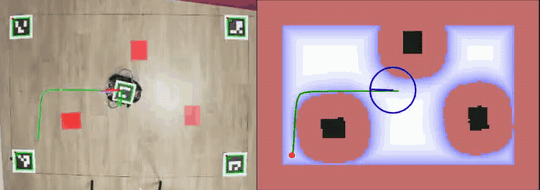

# Robot Nav

Camera-guided navigation for a self-built two-wheeled robot, written from scratch in C++17. An overhead camera localises the robot through fiducial markers and detects obstacles; an extended Kalman filter, an A* planner and two controllers (Pure Pursuit and MPPI) drive it to goals clicked on screen. The same code runs in a simulator and on the real robot.

## Pipeline

| Stage | Method |
|---|---|
| Camera | iPhone, 1920 × 1080 at 30 fps; ChArUco intrinsics; floor pose from 4 ArUco markers |
| Localisation | rays through the roof-marker corners intersected with the roof plane |
| Obstacles | HSV segmentation, floor projection, 20-frame vote |
| Estimation | EKF on (x, y, θ, v, ω); camera delay compensated by replaying the last 2 s of commands; Mahalanobis gating |
| Planning | A* on a 1 cm occupancy grid inflated with a linear-time distance transform; shortcutting and smoothing |
| Control | Pure Pursuit; MPPI (512 samples, 1.5 s horizon) |
| Robot | Arduino firmware applies wheel PWM received over UDP (ESP8266) or USB; 300 ms watchdog |

## Results

Real robot, 3 flat red obstacles, 5 chained goals (videos: [Pure Pursuit](docs/media/real_pp.mp4), [MPPI](docs/media/real_mppi.mp4)):

| Controller | Goals reached | Final error (median / max) | Time per goal (median) | Obstacle contacts |
|---|---|---|---|---|
| Pure Pursuit | 5 / 5 | 0.9 / 1.7 cm | 7.4 s | 2 |
| MPPI | 5 / 5 | 1.0 / 1.1 cm | 7.6 s | 0 |

Simulation, 5 seeds per scenario, camera rendering and EKF in the loop:
